# AI Lead Qualifier & Appointment Booker (n8n)

A website chat assistant that answers questions, qualifies leads, books real appointments and hands off to a person when it should. It's built with **n8n**, **Groq** and **Postgres**, and runs on any server with Docker.

The demo business is **BrightSmile Dental**, a fictional clinic in Cebu. Swap the clinic info file and it works for any appointment-based business: clinics, salons, law firms, home services, real estate.

## The problem

Most small businesses answer website enquiries hours later, and by then the lead has booked somewhere else. Front-desk staff also spend much of the day answering the same questions about prices, hours and HMO coverage.

## What it does

- **Answers FAQs** (services, prices, hours, HMO, location) from one Markdown file the client can edit.
- **Qualifies every visitor**: name, phone or email, service, urgency, preferred time, new or returning, payment. Each detail is saved to the CRM as soon as the patient mentions it.
- **Scores leads 0–100** and tags them `hot` / `warm` / `cold`, `emergency`, `new-patient` and `hmo`. Staff get an email the moment a lead turns hot or reports an emergency.
- **Books real appointments** in Google Calendar. Slots respect opening hours, the lunch break and service length (30, 60 or 90 min). The slot is re-checked right before booking, and a Postgres exclusion constraint makes **double booking impossible** even if two patients pick the same slot at once. The patient gets a confirmation email.
- **Hands off to a human** when asked, when unsure, or in an emergency. Staff get the full transcript by email.
- **Follows up automatically**: nudges after 24h and 72h for leads who didn't book, plus a reminder the day before each appointment. Each one is sent only once.
- **Guardrails**: no diagnoses or medicine advice, real emergencies are sent to the ER or 911, it stays on topic and resists prompt injection. It replies in English, Filipino, Cebuano or Taglish.
- **Funnel analytics** as SQL views: leads per day, booking rate, handoff rate.

## Architecture

```mermaid
flowchart LR
  site[Clinic website<br/>n8n chat widget] -->|message| trigger[Chat Trigger]
  trigger --> agent[AI Agent<br/>Groq gpt-oss-120b]
  memory[(Postgres chat memory)] <--> agent
  agent -->|tool| save[save_lead<br/>normalise + score]
  agent -->|tool| avail[check_availability<br/>free slots]
  agent -->|tool| book[book_appointment<br/>re-check + book]
  agent -->|tool| handoff[handoff_to_human]
  save --> crm[(Postgres CRM)]
  book --> crm
  handoff --> crm
  avail --> gcal[Google Calendar]
  book --> gcal
  save -. hot / emergency .-> gmail[Gmail alerts]
  book -. confirmation .-> gmail
  handoff -. transcript .-> gmail
  cron[Every 15 min] --> follow[Follow-ups workflow] --> crm
  follow --> gmail
```



Each tool is its own **sub-workflow**, so the business rules (scoring, opening hours, slot checks) live in plain JavaScript Code nodes and not in the prompt. That makes them **unit-tested** and predictable. The agent decides *what* to do, and the tools decide *whether it's allowed*.

| Workflow | What it does |
|---|---|
| `lead-agent.json` | Chat Trigger → AI Agent with memory and four tools |
| `tool-save-lead.json` | Merges new details with the saved lead, normalises PH mobile numbers and email, scores, upserts, alerts staff |
| `tool-check-availability.json` | Reads the day's calendar events and builds free slots in clinic time |
| `tool-book-appointment.json` | Checks the patient is on file, re-checks the slot, saves (DB guards overlaps), creates the event, emails a confirmation |
| `tool-handoff.json` | Saves a handoff with the transcript and emails staff |
| `followups.json` | Scheduled nudges and appointment reminders |

## Run it

Everything is free: n8n and Postgres run in Docker, Groq has a free tier, and Google APIs are free at this volume.

1. `cp .env.example .env` and fill it in:
   - `GROQ_API_KEY` from [console.groq.com/keys](https://console.groq.com/keys)
   - `GOOGLE_CLIENT_ID` / `GOOGLE_CLIENT_SECRET`: a Google Cloud OAuth client (type *Web application*, redirect URI `http://localhost:5678/rest/oauth2-credential/callback`) with the Calendar and Gmail APIs enabled
   - `CALENDAR_ID` (your Gmail address works) and `STAFF_EMAIL`
2. `./scripts/setup.sh`. This starts n8n, Postgres and the demo site, imports the credentials and workflows, and publishes them.
3. In n8n (http://localhost:5678), open the **Google Calendar** and **Gmail** credentials, click *Sign in with Google*, then publish **Follow-ups and reminders**.
4. Open the clinic site at http://localhost:8080 and chat with Bea.

## Tests

```sh
npm install
npm test        # 41 unit tests for the Code-node logic and workflow wiring, no n8n needed
npm run eval    # 6 scripted conversations against the live stack, checked in Postgres
```

The unit tests run the JavaScript **straight from the workflow JSON**, so the workflow files stay the single source of truth with no build step. They cover:

- lead scoring, merging and contact normalisation
- slot building: hours, lunch, durations, busy events, all-day events, Sundays, lead time, timezone
- the booking re-check, transcript formatting and follow-up emails
- that every tool's inputs match its sub-workflow

The eval covers:

- a price FAQ
- a full qualify-and-book conversation (the phone number is normalised, the lead is set to `booked`, and the appointment has a calendar event)
- an emergency sent to the ER, plus a handoff
- a request for a person
- a prompt-injection attempt
- a request for medicine advice

## Customise it for a client

| Change | Where |
|---|---|
| Services, prices, hours text, policies | `knowledge/clinic.md`, then `npm run sync` and re-run setup |
| Opening hours, slot length, service durations | `HOURS`, `STEP_MINUTES`, `DURATIONS` in the **Build Free Slots** node |
| Lead scoring rules and hot/warm thresholds | **Normalize and Score** node |
| Assistant name, tone, rules | System message of the **AI Agent** node |
| Website allowed to embed the chat | *Allowed Origins* on the **Chat Trigger** node |
| Model | **Groq Chat Model** node (or swap in OpenAI, Claude or Gemini) |

Embed the widget on any site with the snippet in `site/index.html`. Pass `?n8n=https://your-n8n-domain` to point the demo page at a deployed instance.

## Analytics

```sql
SELECT * FROM v_funnel;        -- conversations, qualified, booked, booking rate
SELECT * FROM v_daily_leads;   -- leads, hot leads and bookings per day
SELECT * FROM v_handoff_rate;  -- how often the bot needs a human
```

## Roadmap

- [ ] WhatsApp channel (Meta Cloud API) on the same agent and tools
- [ ] Voice channel (Vapi / Retell) for missed calls
- [ ] Metabase dashboard on the analytics views
- [ ] Multiple dentists, each with their own calendar
- [ ] RAG over clinic PDFs for longer knowledge bases
- [ ] SMS reminders
- [ ] Deploy to Supabase + a VPS with HTTPS

## Stack

n8n 2.44 · Groq (`openai/gpt-oss-120b`) · Postgres 17 · Google Calendar · Gmail · Docker Compose · Node.js 22 (`node:test`, Luxon)
